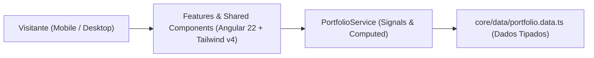

# Arquitetura — portifolio-gdr

## Visão Geral

Aplicação SPA 100% em **Angular 22** com foco em **Mobile-First**, arquitetura modular e dados tipados localmente em TypeScript (fácil de migrar para CMS ou API no futuro, pois o acesso passa por `PortfolioService`).



## Estrutura de Pastas

```text
portifolio-gdr/
├── .agents/
│   └── skills/                 # Skills sob demanda (Angular + Design)
├── docs/                       # Documentação técnica
│   ├── ARCHITECTURE.md
│   ├── DESIGN_SYSTEM.md
│   └── TECH_STACK.md
├── frontend/                   # Aplicação Angular 22 (TypeScript + Tailwind v4)
│   ├── .postcssrc.json         # Configuração PostCSS para Tailwind v4
│   └── src/app/
│       ├── core/
│       │   ├── models/         # Interfaces TypeScript (Profile, Experience, Project, SkillGroup)
│       │   ├── data/           # Dados do portfólio em PT-BR (edite aqui seu conteúdo)
│       │   └── services/       # PortfolioService com estado reativo via Signals
│       ├── shared/
│       │   ├── components/     # navbar/, social-icon/
│       │   └── directives/     # reveal.ts (RevealDirective — animação ao entrar na viewport)
│       └── features/
│           └── home/
│               ├── home.ts     # Compõe navbar, seções e footer
│               └── sections/   # hero, about, experience, projects, technologies, contact, section-heading
├── AGENTS.md                   # Regras globais para agentes
└── README.md
```

## Modelo de Dados (`core/models/portfolio.model.ts`)

- **`Profile`**: `fullName`, `brand`, `brandSuffix`, `role`, `intro`, `coreStack` (`CoreTech[]`: `layer`, `name`, `language`), `aboutTitle`, `bio`, `facts` (`label`, `value`), `availability`, `contactMessage`, `email`, `socials` (`label`, `url`, `icon`)
- **`Project`**: `slug`, `title`, `kind` (`Fullstack` | `Web` | `API` | `Mobile`), `year`, `description`, `highlights`, `stack`, `repoUrl?`, `liveUrl?` — filtrado por tecnologia via `PortfolioService.filteredProjects`
- **`SkillGroup`**: `category` (`frontend` | `backend` | `mobile` | `tools`), `label`, `title`, `items`
- **`Experience`**: `id`, `role`, `company`, `period`, `location`, `current`, `highlights`, `stack`

## Seções e Âncoras

Página única com navegação por âncoras, nesta ordem: `#inicio` → `#sobre` → `#experiencia` → `#projetos` → `#tecnologias` → `#contato`.

## Abordagem Mobile-First

- Layout base pensado para viewports de **360px a 430px** (1 coluna, navegação compacta com menu mobile deslizável, botões com área de toque mínima de `44px`).
- Adaptação progressiva via breakpoints Tailwind (`sm:`, `md:`, `lg:`) para tablets e desktops (`max-w-6xl` centralizado).
